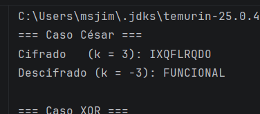
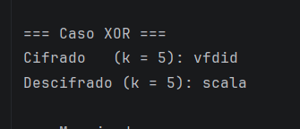
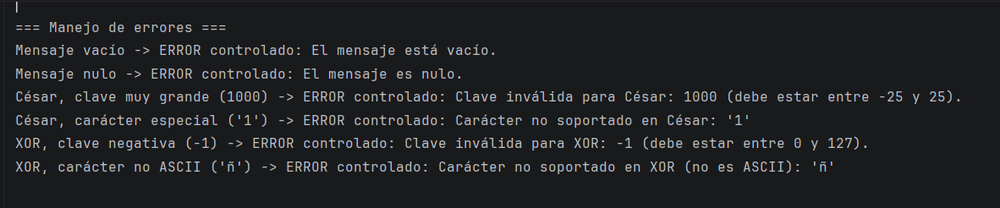

# Mini Proyecto: Higher Order Functions en Criptografía


## 1. Introducción

Este proyecto implementa un **motor de cifrado** en Scala. El motor no tiene un cifrado
fijo: recibe como parámetro una **función de transformación**, de modo que se pueden
cambiar las estrategias sin modificar el motor. Se implementan dos métodos clásicos: el
cifrado **César** y el cifrado **XOR**. Además, se maneja de forma controlada los errores
más comunes (mensajes vacíos o nulos, claves inválidas y caracteres no soportados).

## 2. Objetivos

- Aplicar funciones de orden superior (*Higher Order Functions*).
- Usar funciones como parámetros para definir estrategias de cifrado dinámicas.
- Transformar colecciones inmutables con `map`.
- Manejar excepciones y validar datos de entrada.

## 3. CONCEPTOS

### 3.1 ¿Qué es cifrar?

Cifrar es transformar un mensaje para que no pueda entenderse sin conocer la **regla** y
la **clave** con las que se transformó. Intervienen dos elementos:

| Elemento | Descripción |
|---|---|
| **Algoritmo** | La regla de transformación (por ejemplo, "mover letras" o "mezclar bits"). |
| **Clave** | El dato secreto que ajusta la regla (por ejemplo, cuántas posiciones mover). |

Los dos métodos de este proyecto son **simétricos**: la misma clave (o su inversa) sirve
para cifrar y para descifrar. También son métodos **didácticos**: son fáciles de romper y
no se usan para proteger información real, pero sirven para entender la base de la criptografía.

### 3.2 Cifrado César

**Idea general.** Imagina el abecedario escrito en una rueda. Con clave 3, cada letra se
reemplaza por la que está 3 lugares adelante: la A pasa a ser D, la B pasa a ser E, y así
sucesivamente. Al llegar al final, la rueda da la vuelta: la X pasa a ser A. Para
descifrar se retrocede la misma cantidad de lugares.

**Funcionamiento técnico.** Cada letra se convierte a su posición en el alfabeto
(A=0, B=1, ..., Z=25) y se aplica la fórmula:

```
E(x, k) = (pos(x) + k) mod 26
```

- `x` es el carácter y `k` la clave (un entero).
- El **módulo 26** hace que, después de la Z, se vuelva a la A.
- Para **descifrar** se usa la clave `-k`. Como en programación el resto (`%`) puede dar
  negativos, el código usa `((n % 26) + 26) % 26` para obtener siempre un valor entre 0 y 25.

**Ejemplo rápido** (mensaje `AD`, clave `k = 1`):

| Letra | Posición | (pos + 1) mod 26 | Resultado |
|---|---|---|---|
| A | 0 | 1 | B |
| D | 3 | 4 | E |

Resultado: `BE`.

### 433 Cifrado XOR

**Idea general.** Dentro de la computadora, cada letra es un número, y la clave es otro
número. El cifrado XOR mezcla ambos números bit por bit con una regla simple: si los dos
bits son iguales el resultado es 0, y si son distintos el resultado es 1. Lo interesante
es que **aplicar la misma mezcla dos veces devuelve el original**, igual que presionar dos
veces un interruptor.

**Funcionamiento técnico.** Se toma el código ASCII del carácter y se le aplica la
operación *Exclusive OR* con la clave:

```
E(x, k) = ASCII(x) ⊕ k      (en Scala: caracter.toInt ^ clave)
```

Tabla de verdad de XOR:

| A | B | A ⊕ B |
|---|---|---|
| 0 | 0 | 0 |
| 0 | 1 | 1 |
| 1 | 0 | 1 |
| 1 | 1 | 0 |

**Ejemplo con la letra `'s'` y clave `k = 5`:**

```
's' = 115 = 0111 0011
 5        = 0000 0101
XOR       = 0111 0110 = 118 = 'v'
```

**Propiedad clave:** `(a ⊕ k) ⊕ k = a`. Por eso el mismo proceso, con la misma clave,
cifra y descifra.

**Tabla completa para `scala` con `k = 5`:**

| Carácter | ASCII | XOR 5 | Resultado ASCII | Cifrado |
|---|---|---|---|---|
| s | 115 | 115 ⊕ 5 | 118 | v |
| c | 99 | 99 ⊕ 5 | 102 | f |
| a | 97 | 97 ⊕ 5 | 100 | d |
| l | 108 | 108 ⊕ 5 | 105 | i |
| a | 97 | 97 ⊕ 5 | 100 | d |

Resultado final: `vfdid`.

### 3.4 Funciones de orden superior

Una **función de orden superior** (*Higher Order Function*) es una función que recibe otras
funciones como parámetros o las devuelve como resultado. En este proyecto, el motor
`procesarMensaje` recibe la estrategia de cifrado como una función de tipo
`(Char, Int) => Char`. Así, el mismo motor sirve para César, XOR o cualquier método futuro.

También se usa `map`, que aplica una función a cada elemento de una colección **sin
modificarla** y devuelve una colección nueva (inmutabilidad).

## 4. Desarrollo

###  Código fuente


```scala
import scala.util.{Failure, Success, Try}

/**
 * Mini Proyecto: Higher Order Functions en Criptografía
 * Asignatura: Programación Funcional y Reactiva
 *
 * Motor de cifrado que recibe la estrategia de cifrado (una función)
 * como parámetro. Se implementan dos estrategias: César y XOR.
 */
object MotorCifrado {


  // 1. Función de orden superior
 
  def procesarMensaje(mensaje: String, clave: Int, cifrado: (Char, Int) => Char): Try[String] =
    Try {
      if (mensaje == null) throw new IllegalArgumentException("El mensaje es nulo.")
      if (mensaje.isEmpty) throw new IllegalArgumentException("El mensaje está vacío.")
      mensaje.map(caracter => cifrado(caracter, clave))
    }

  // 2. Estrategias de cifrado
 

  /** Cifrado César: E(x, k) = (pos(x) + k) mod 26. Solo letras A-Z y a-z. */
  val cesar: (Char, Int) => Char = (caracter, clave) => {
    if (clave < -25 || clave > 25)
      throw new IllegalArgumentException(s"Clave inválida para César: $clave (debe estar entre -25 y 25).")

    if (caracter >= 'A' && caracter <= 'Z')
      desplazar(caracter, 'A', clave)
    else if (caracter >= 'a' && caracter <= 'z')
      desplazar(caracter, 'a', clave)
    else
      throw new IllegalArgumentException(s"Carácter no soportado en César: '$caracter'")
  }

  // Desplaza una letra respecto a la base ('A' o 'a'); el doble módulo evita negativos.
  private def desplazar(caracter: Char, base: Char, clave: Int): Char =
    (((caracter - base + clave) % 26 + 26) % 26 + base).toChar

  /** Cifrado XOR: E(x, k) = ASCII(x) ^ k. Solo caracteres ASCII (0-127). */
  val xor: (Char, Int) => Char = (caracter, clave) => {
    if (clave < 0 || clave > 127)
      throw new IllegalArgumentException(s"Clave inválida para XOR: $clave (debe estar entre 0 y 127).")
    if (caracter.toInt > 127)
      throw new IllegalArgumentException(s"Carácter no soportado en XOR (no es ASCII): '$caracter'")

    (caracter.toInt ^ clave).toChar
  }

  // 3. Pruebas

  // Muestra el resultado de un Try de forma elegante
  private def mostrar(titulo: String, resultado: Try[String]): Unit =
    resultado match {
      case Success(texto) => println(s"$titulo: $texto")
      case Failure(error) => println(s"$titulo -> ERROR controlado: ${error.getMessage}")
    }

  def main(args: Array[String]): Unit = {

    println("=== Caso César ===")
    val cifradoCesar = procesarMensaje("FUNCIONAL", 3, cesar)
    mostrar("Cifrado   (k = 3)", cifradoCesar)
    mostrar("Descifrado (k = -3)", cifradoCesar.flatMap(texto => procesarMensaje(texto, -3, cesar)))

    println("\n=== Caso XOR ===")
    val cifradoXor = procesarMensaje("scala", 5, xor)
    mostrar("Cifrado   (k = 5)", cifradoXor)
    mostrar("Descifrado (k = 5)", cifradoXor.flatMap(texto => procesarMensaje(texto, 5, xor)))

    println("\n=== Manejo de errores ===")
    mostrar("Mensaje vacío", procesarMensaje("", 3, cesar))
    mostrar("Mensaje nulo", procesarMensaje(null, 3, cesar))
    mostrar("César, clave muy grande (1000)", procesarMensaje("HOLA", 1000, cesar))
    mostrar("César, carácter especial ('1')", procesarMensaje("HOLA1", 3, cesar))
    mostrar("XOR, clave negativa (-1)", procesarMensaje("scala", -1, xor))
    mostrar("XOR, carácter no ASCII ('ñ')", procesarMensaje("año", 5, xor))
  }
}
```

###  Piezas del programa

| Pieza | Función |
|---|---|
| `procesarMensaje` | Motor de orden superior. Valida el mensaje, aplica la función de cifrado a cada carácter con `map` y devuelve un `Try[String]`. |
| `cesar` | Estrategia César. Acepta letras `A-Z` y `a-z` y claves de `-25` a `25`. |
| `xor` | Estrategia XOR. Acepta caracteres ASCII (código ≤ 127) y claves de `0` a `127`. Usa el operador `^`. |
| `Try` | Envuelve el resultado: `Success(texto)` si todo sale bien o `Failure(error)` si algo falla, sin detener el programa. |
| `main` | Ejecuta las pruebas pedidas: caso César, caso XOR y manejo de errores. |

###  Manejo de excepciones

| Situación | Dónde se valida |
|---|---|
| Mensaje nulo o vacío | `procesarMensaje` |
| Clave inválida | `cesar` y `xor` |
| Carácter no soportado | `cesar` y `xor` |

Al estar dentro de `Try`, cada error se convierte en un `Failure` y se muestra con un mensaje claro.

##  Ejemplos y resultados

### 6.1 Caso César

Cifrar `FUNCIONAL` con `k = 3` y luego descifrar con `k = -3`.

| Operación | Entrada | Clave | Salida |
|---|---|---|---|
| Cifrar | `FUNCIONAL` | 3 | `IXQFLRQDO` |
| Descifrar | `IXQFLRQDO` | -3 | `FUNCIONAL` |

```scala
val cifradoCesar = procesarMensaje("FUNCIONAL", 3, cesar)
mostrar("Cifrado   (k = 3)", cifradoCesar)
mostrar("Descifrado (k = -3)", cifradoCesar.flatMap(texto => procesarMensaje(texto, -3, cesar)))
```



### Caso XOR

Cifrar `scala` con `k = 5` y volver a aplicar la misma función con la misma clave.

| Operación | Entrada | Clave | Salida |
|---|---|---|---|
| Cifrar | `scala` | 5 | `vfdid` |
| Aplicar de nuevo | `vfdid` | 5 | `scala` |

```scala
val cifradoXor = procesarMensaje("scala", 5, xor)
mostrar("Cifrado   (k = 5)", cifradoXor)
mostrar("Descifrado (k = 5)", cifradoXor.flatMap(texto => procesarMensaje(texto, 5, xor)))
```



### Manejo de errores

Pruebas donde se fuerza el fallo para demostrar la robustez del código.

| Prueba | Resultado |
|---|---|
| Mensaje vacío | `ERROR controlado: El mensaje está vacío.` |
| Mensaje nulo | `ERROR controlado: El mensaje es nulo.` |
| César con clave 1000 | `ERROR controlado: Clave inválida para César: 1000 (debe estar entre -25 y 25).` |
| César con `'1'` | `ERROR controlado: Carácter no soportado en César: '1'` |
| XOR con clave -1 | `ERROR controlado: Clave inválida para XOR: -1 (debe estar entre 0 y 127).` |
| XOR con `'ñ'` | `ERROR controlado: Carácter no soportado en XOR (no es ASCII): 'ñ'` |




## Preguntas de reflexión

**¿Por qué XOR es su propia función inversa, mientras que César requiere invertir el signo de la clave?**
Porque XOR cumple `(a ⊕ k) ⊕ k = a`: cada bit cambia con `k` y vuelve a su valor original al
aplicar la misma clave. En César el cifrado es una suma, y para deshacerla hay que restar
(clave `-k`, equivalente a `26 - k`).

**¿Qué ventajas ofrece `map` sobre un bucle `for` tradicional?**
`map` es declarativo: expresa *qué* transformación se aplica, no *cómo* recorrer. No
requiere variables mutables ni índices, devuelve una colección nueva (inmutabilidad) y el
código es más corto y fácil de razonar.

**¿Cómo ayuda el tipado estático a prevenir errores al pasar funciones como argumentos?**
El compilador exige que la función tenga el tipo `(Char, Int) => Char`. Si se pasa una
función con otra firma, el error aparece al compilar y no en tiempo de ejecución.

##  Conclusiones

- Pasar la estrategia de cifrado como parámetro permite agregar nuevos algoritmos sin modificar `procesarMensaje`.
- `Try` permite manejar los errores como valores, de forma controlada.
- `map` sobre colecciones inmutables hace el código más simple y seguro.
- César y XOR muestran dos ideas distintas: desplazar letras y mezclar bits. Ambos son útiles para aprender, aunque no son seguros para uso real.
